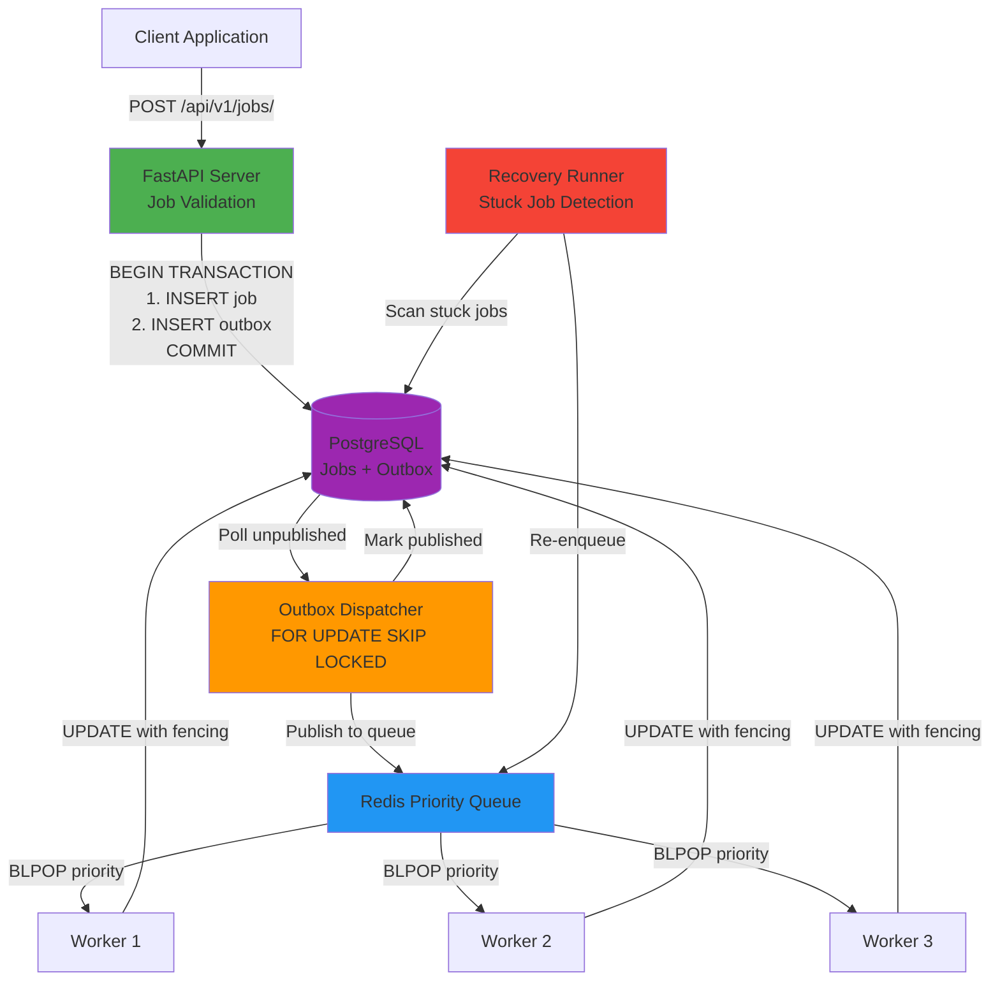

# Distributed Job Processing Platform

A distributed job processing platform built with Python, FastAPI, PostgreSQL, and Redis to handle asynchronous workloads reliably. The system combines transactional outbox messaging, priority-based scheduling, concurrent workers, automatic retries, and failure recovery to address common challenges in distributed task execution.

<p align="center">
  <a href="#overview">Overview</a> •
  <a href="#features">Features</a> •
  <a href="#architecture">Architecture</a> •
  <a href="#getting-started">Getting Started</a> •
  <a href="#usage">Usage</a> •
  <a href="#testing">Testing</a> •
  <a href="#monitoring">Monitoring</a>
</p>

---

## Overview

### The Problem

Modern distributed systems often need to process background jobs asynchronously. A common pattern is to save a job record to a database and immediately publish a message to a queue like Redis. This works until something fails:

- Database commits but Redis publish fails → job persisted but never executed
- Redis publish succeeds but database commit fails → worker processes against inconsistent state
- Network partition between API and Redis → job may be lost or duplicated

This dual-write problem creates reliability gaps that are difficult to reason about.

### The Solution: Transactional Outbox Pattern

This platform uses the **transactional outbox pattern** to ensure jobs are reliably delivered:

1. **Atomic Write** - Job record and outbox event are written in a single database transaction
2. **Async Dispatch** - A separate dispatcher polls the outbox table and publishes to Redis
3. **Delivery Guarantee** - Jobs survive Redis failures, network partitions, and application crashes
4. **At-Least-Once Semantics** - Jobs may be delivered multiple times; handlers must be idempotent

**Tradeoff**: This adds latency (polling interval + database round-trip) in exchange for durability and auditability.

### Why I Built This

I wanted to understand how distributed systems handle asynchronous job processing with reliability guarantees. The outbox pattern addresses the dual-write problem without requiring distributed transactions or complex two-phase commits. This implementation focuses on:

- **Reliability** - Jobs aren't lost during failures
- **Concurrency** - Multiple workers coordinate via PostgreSQL without external consensus
- **Observability** - Structured logs, Prometheus metrics, and real-time WebSocket updates
- **Recovery** - Automatic detection and re-queueing of stuck jobs

The system processes six simulated job types (data processing, email notifications, report generation, data sync, image processing, backups) to demonstrate the execution framework. These handlers use mock delays and return sample data rather than performing actual business operations.

## Features

### Core Capabilities

- **Transactional Outbox Pattern** - Atomic job creation with PostgreSQL-backed delivery guarantees
- **Concurrent Workers** - Multiple workers process jobs in parallel with automatic coordination
- **Priority Queue** - 0-10 priority levels (lower number = higher priority)
- **Worker Fencing** - Prevents stale worker updates after timeouts using retry attempt tracking
- **Automatic Retry** - Configurable max retries with exponential backoff
- **Dead Letter Queue** - Isolates exhausted jobs for manual review
- **Idempotency Keys** - Client-provided keys prevent duplicate job creation
- **Job Recovery** - Detects and re-queues stuck jobs automatically
- **Real-time Updates** - WebSocket support for live job status changes
- **Prometheus Metrics** - Job throughput, latency, failure rates, and queue depth
- **RESTful API** - FastAPI with automatic OpenAPI documentation

### Technical Highlights

- **PostgreSQL FOR UPDATE SKIP LOCKED** for safe concurrent outbox polling
- **Redis ZADD priority scoring** for priority queue implementation
- **Async/await throughout** using Python's asyncio
- **Type safety** with Pydantic models and comprehensive type hints
- **Connection pooling** for PostgreSQL and Redis
- **Structured JSON logging** with contextual information
- **Docker Compose orchestration** with 9 services
- **Comprehensive test suite** with 345 passing tests

## Architecture

### System Overview



### Job Lifecycle

**1. Job Submission**
```
Client → API: POST /api/v1/jobs/
API → PostgreSQL: BEGIN TRANSACTION
  - INSERT INTO jobs (id, job_type, payload, priority, status='queued', ...)
  - INSERT INTO job_outbox (job_id, event_type='job_created', ...)
API → PostgreSQL: COMMIT
API → Client: 201 Created {job_id, status: "queued"}
```

**2. Outbox Publishing**
```
Dispatcher polls: SELECT ... FROM job_outbox
                  WHERE published_at IS NULL
                  FOR UPDATE SKIP LOCKED LIMIT 10
Dispatcher → Redis: ZADD queue {priority} {job_id}
Dispatcher → PostgreSQL: UPDATE job_outbox SET published_at = NOW()
```

**3. Worker Execution**
```
Worker → Redis: BLPOP queue (blocking, priority-ordered)
Worker → PostgreSQL: UPDATE jobs SET status='processing', worker_id='worker-1'
                     WHERE id = ? AND status = 'queued'  -- Atomic claim
Worker executes job handler
Worker → PostgreSQL: UPDATE jobs SET status='completed', result=?
                     WHERE id = ? AND worker_id = 'worker-1'  -- Fencing
```

**4. Failure & Retry**
```
On failure:
Worker → PostgreSQL: UPDATE jobs SET status='retrying', retry_count=retry_count+1
Worker → Redis: ZADD queue {priority} {job_id, retry_attempt}

On exhaustion (retry_count >= max_retries):
Worker → PostgreSQL: UPDATE jobs SET status='dead_letter', is_dead_letter=true
```

### Key Patterns

#### Transactional Outbox

The outbox pattern solves the dual-write problem by making job delivery a two-phase process:

**Phase 1: Atomic Persistence**
- Job record and outbox event are written in a single PostgreSQL transaction
- If the transaction fails, nothing is committed
- If the transaction succeeds, delivery is guaranteed

**Phase 2: Async Publishing**
- Separate dispatcher process polls unpublished outbox events
- Uses `FOR UPDATE SKIP LOCKED` to allow multiple dispatcher instances
- Publishes to Redis and marks event as published
- If dispatcher crashes, unpublished events remain in database for retry

**Delivery Semantics:**
- **At-Least-Once** - Jobs may be published multiple times if dispatcher crashes after Redis publish but before marking as published
- **Idempotency Required** - Job handlers must handle duplicate executions safely

#### Worker Fencing

Fencing prevents race conditions when multiple workers process the same job:

```python
# Worker claims job
UPDATE jobs
SET status = 'processing', worker_id = 'worker-1', started_at = NOW()
WHERE id = ? AND status = 'queued'  -- Atomic claim

# Worker completes with fencing
UPDATE jobs
SET status = 'completed', result = ?, completed_at = NOW()
WHERE id = ? AND worker_id = 'worker-1' AND status = 'processing'
-- ^^^^^^^^^ Fencing: only THIS worker can update
```

**Scenario:**
1. Worker 1 claims job, starts processing
2. Worker 1 appears stuck (network issue, long GC pause)
3. Recovery detects timeout, re-enqueues with new retry_attempt
4. Worker 2 claims job with retry_attempt=1
5. Worker 1 finally completes → UPDATE fails (retry_attempt mismatch)
6. Worker 2's completion succeeds

#### Job Recovery

Automatic recovery detects and re-queues stuck jobs:

```python
# Recovery runner scans for stuck jobs every 60 seconds
SELECT * FROM jobs
WHERE status = 'processing'
  AND started_at < NOW() - INTERVAL '5 minutes'
  AND last_heartbeat_at < NOW() - INTERVAL '2 minutes'

# Creates recovery event in outbox
INSERT INTO job_outbox (job_id, event_type='job_recovered', retry_attempt=...)

# Dispatcher publishes to queue with retry_attempt
# Workers validate retry_attempt before claiming
```

## Technology Stack

| Component | Technology | Purpose |
|-----------|-----------|---------|
| **API** | FastAPI 0.115+ | Async REST API with OpenAPI docs |
| **Database** | PostgreSQL 15 | Job persistence and outbox table |
| **ORM** | SQLAlchemy 2.0 (async) | Database operations with full async support |
| **Queue** | Redis 7 | Priority queue for job distribution |
| **Language** | Python 3.11+ | Core application language (compatible with 3.13) |
| **Migrations** | Alembic | Database schema versioning |
| **Monitoring** | Prometheus | Metrics collection and visualization |
| **Container** | Docker Compose | Local development environment |
| **Testing** | Pytest, pytest-asyncio | Test automation (345 passing tests) |

## Getting Started

### Prerequisites

- Docker and Docker Compose
- Python 3.11+ (optional, for local development)
- Git

### Quick Start

1. **Clone repository**
   ```bash
   git clone https://github.com/Latha2308/distributed-job-processing-platform.git
   cd distributed-job-processing-platform
   ```

2. **Configure environment**
   ```bash
   cp .env.example .env
   ```

   Edit `.env` and set a secure SECRET_KEY:
   ```bash
   # Generate a secure key
   python -c "import secrets; print(secrets.token_urlsafe(32))"

   # Update SECRET_KEY in .env
   SECRET_KEY=your-generated-key-here
   ```

3. **Start all services**
   ```bash
   docker-compose up -d
   ```

   This starts 9 services:
   - `postgres` - PostgreSQL 15 database
   - `redis` - Redis 7 queue
   - `api` - FastAPI server (port 8000)
   - `worker1`, `worker2`, `worker3` - Three worker instances
   - `dispatcher` - Outbox dispatcher process
   - `recovery` - Stuck job recovery runner
   - `prometheus` - Metrics collection (port 9090)

4. **Verify services**
   ```bash
   docker-compose ps
   curl http://localhost:8000/health
   # Expected: {"status":"healthy","version":"1.0.0"}
   ```

5. **Access services**
   - **API Docs**: http://localhost:8000/docs
   - **API**: http://localhost:8000/api/v1/jobs/
   - **Metrics**: http://localhost:8000/metrics
   - **Prometheus**: http://localhost:9090

### Manual Setup (Development)

<details>
<summary>Click to expand manual setup instructions</summary>

1. **Create virtual environment**
   ```bash
   python3 -m venv venv
   source venv/bin/activate  # Windows: venv\Scripts\activate
   ```

2. **Install dependencies**
   ```bash
   pip install -r requirements.txt
   ```

3. **Start infrastructure**
   ```bash
   docker-compose up -d postgres redis prometheus
   ```

4. **Configure environment**
   ```bash
   cp .env.example .env
   # Edit .env with your configuration
   ```

5. **Run migrations**
   ```bash
   alembic upgrade head
   ```

6. **Start services** (in separate terminals)
   ```bash
   # Terminal 1: API
   uvicorn app.main:app --reload --host 0.0.0.0 --port 8000

   # Terminal 2: Dispatcher
   python -m app.dispatcher.dispatcher_cli \
     --dispatcher-id dispatcher-01 --batch-size 10 --poll-interval 5.0

   # Terminal 3-5: Workers
   python -m app.worker.worker --worker-id worker-1
   python -m app.worker.worker --worker-id worker-2
   python -m app.worker.worker --worker-id worker-3

   # Terminal 6: Recovery
   python -m app.recovery.recovery_cli \
     --runner-id recovery-01 --batch-size 10 --poll-interval 60
   ```
</details>

## Usage

### Create a Job

```bash
curl -X POST http://localhost:8000/api/v1/jobs/ \
  -H "Content-Type: application/json" \
  -d '{
    "job_type": "data_processing",
    "payload": {"data": [1, 2, 3, 4, 5]},
    "priority": 5,
    "max_retries": 3,
    "timeout": 300
  }'
```

**Response:**
```json
{
  "id": "a3b4c5d6-e7f8-9012-3456-789abcdef012",
  "job_type": "data_processing",
  "payload": {"data": [1, 2, 3, 4, 5]},
  "priority": 5,
  "status": "queued",
  "created_at": "2024-01-15T10:30:00Z",
  "max_retries": 3,
  "retry_count": 0,
  "timeout": 300
}
```

### Create Job with Idempotency

```bash
curl -X POST http://localhost:8000/api/v1/jobs/ \
  -H "Content-Type: application/json" \
  -d '{
    "job_type": "email_notification",
    "payload": {"recipient": "user@example.com", "subject": "Welcome"},
    "idempotency_key": "welcome-email-user123",
    "priority": 1
  }'
```

Resubmitting with the same `idempotency_key` returns the original job without creating a duplicate.

### Check Job Status

```bash
# Get specific job
curl http://localhost:8000/api/v1/jobs/a3b4c5d6-e7f8-9012-3456-789abcdef012

# List all jobs
curl http://localhost:8000/api/v1/jobs/

# Filter by status
curl "http://localhost:8000/api/v1/jobs/?status=completed&page_size=20"
```

### Supported Job Types

The platform includes six simulated job handlers that demonstrate the execution framework:

1. **data_processing** - Simulates batch data processing (3-second delay)
   ```json
   {"job_type": "data_processing", "payload": {"data": [1,2,3,4,5]}}
   ```

2. **email_notification** - Simulates email sending (2-second delay)
   ```json
   {"job_type": "email_notification", "payload": {"recipient": "user@example.com"}}
   ```

3. **report_generation** - Simulates report creation (5-second delay)
   ```json
   {"job_type": "report_generation", "payload": {"report_type": "sales"}}
   ```

4. **data_sync** - Simulates database synchronization (4-second delay)
   ```json
   {"job_type": "data_sync", "payload": {"source": "db1", "destination": "db2"}}
   ```

5. **image_processing** - Simulates image transformations (6-second delay)
   ```json
   {"job_type": "image_processing", "payload": {"image_url": "...", "operations": ["resize"]}}
   ```

6. **backup** - Simulates backup operations (5-second delay)
   ```json
   {"job_type": "backup", "payload": {"resource": "database", "location": "s3://..."}}
   ```

These handlers use `asyncio.sleep()` to simulate work and return mock results. They demonstrate the job execution framework but don't perform actual business operations like sending emails or processing images.

### Real-Time Updates

```javascript
// WebSocket connection for job updates
const ws = new WebSocket('ws://localhost:8000/api/v1/ws/jobs/JOB_ID');

ws.onmessage = (event) => {
  const update = JSON.parse(event.data);
  console.log('Job status:', update.status);
};

// Keep connection alive
setInterval(() => ws.send('ping'), 30000);

// Manually refresh status
ws.send('refresh');
```

## Testing

### Test Suite

**Results**: 345 tests passed, 0 failed (verified November 2024)

The test suite covers:
- Atomic job claiming (33 tests)
- Worker fencing (7 tests)
- Job status fencing (13 tests)
- Recovery integration (23 tests)
- Outbox dispatcher (29 tests)
- Queued job reconciliation (22 tests)
- Reconciliation durability (7 tests)
- Recovery CLI lifecycle (29 tests)
- Recovery eligibility (10 tests)
- Redis connection cleanup (7 tests)
- Worker processing loop (14 tests)
- Concurrent idempotency (14 tests)
- Plus: Migrations, delayed queues, crash scenarios

### Run Tests

```bash
# All tests
pytest

# With coverage
pytest --cov=app --cov-report=html --cov-report=term

# Specific module
pytest tests/test_outbox_dispatcher.py -v

# Fast subset
pytest tests/test_worker_fencing.py tests/test_job_status_fencing.py -v
```

### End-to-End Verification

Verified manually with live Docker Compose environment:

| Scenario | Result | Evidence |
|----------|--------|----------|
| Concurrent processing | ✅ Pass | 5 jobs distributed across 3 workers |
| Idempotency | ✅ Pass | Same key returned identical job ID |
| Retry behavior | ✅ Pass | Job retried 2×, then moved to dead_letter |
| Priority queue | ✅ Pass | High priority (1) started before low (9) |
| All 6 job handlers | ✅ Pass | All completed with mock results |
| Outbox publishing | ✅ Pass | Dispatcher logs show successful publishes |

## Monitoring

### Prometheus Metrics

Access Prometheus at http://localhost:9090

**Available Metrics:**
- `job_submissions_total` - Submissions by type and priority
- `job_completions_total` - Completions by type and status
- `job_processing_duration_seconds` - Processing time histogram
- `job_queue_depth` - Current queue depth by priority
- `active_workers` - Number of active workers
- `job_retries_total` - Retry attempts by type
- `job_failures_total` - Failures by type and error

**Example Queries:**
```promql
# Job completion rate (jobs/second)
rate(job_completions_total[5m])

# Average processing time
avg(job_processing_duration_seconds)

# Success rate percentage
100 * (
  sum(job_completions_total{status="completed"}) /
  sum(job_completions_total)
)

# Queue backlog
sum(job_queue_depth)
```

### Application Logs

```bash
# View all logs
docker-compose logs -f

# Specific service
docker-compose logs -f dispatcher
docker-compose logs -f worker1

# Last 100 lines
docker-compose logs --tail=100 api
```

Logs use structured JSON format:
```json
{
  "event": "outbox_event_published",
  "event_id": "56eb6368-98b3-4c48-be3d-120084b8c10f",
  "job_id": "4ae87669-e435-479e-b0e1-e9b2bb8c05c1",
  "job_type": "data_processing",
  "attempt": 1,
  "level": "info",
  "timestamp": "2024-11-23T13:33:30.033467Z"
}
```

### API Endpoints

- **Health**: `GET /health`
- **Metrics**: `GET /metrics`
- **Job Stats**: `GET /api/v1/jobs/stats/overview`
- **Worker Metrics**: `GET /api/v1/workers/metrics/overview`
- **Queue Status**: `GET /api/v1/monitoring/queue`
- **Dashboard**: `GET /api/v1/monitoring/dashboard`

## Security and Design Considerations

This platform demonstrates distributed job processing patterns with an emphasis on reliability and observability. The current implementation includes:

**What's Implemented:**
- Configurable CORS with safe localhost defaults
- Environment-based configuration with required SECRET_KEY
- Transactional database operations (outbox pattern)
- Idempotency controls to prevent duplicate job creation
- Worker fencing to prevent stale updates

**Development Environment:**
- Docker Compose uses `postgres:postgres` credentials (suitable for local testing only)
- No authentication or authorization layer
- Job payload validation is type-based (Pydantic schemas) but not business-logic constrained

**For Internet-Facing Deployment:**

Authentication, authorization, API rate limiting, and stricter job-specific payload validation would be appropriate additions. Additional production considerations:

- JWT or API key authentication
- Role-based access control
- Per-user rate limiting with Redis backing
- Job payload size limits and content validation
- TLS/HTTPS enforcement
- Secrets management (AWS Secrets Manager, HashiCorp Vault)
- WAF and DDoS protection
- Comprehensive audit logging

## Known Limitations

**Delivery Semantics:**
At-least-once delivery means jobs may be delivered multiple times if the dispatcher crashes after Redis publish but before marking the event as published. Job handlers must be idempotent.

**Job Handlers:**
All six job type handlers are simulations that use `asyncio.sleep()` and return mock data. They demonstrate the execution framework but don't perform actual email sending, image processing, database backups, etc. Real handlers would replace the sleep calls with actual business logic.

**Scaling Characteristics:**
Redis single instance is a bottleneck for high-throughput scenarios (consider Redis Cluster for production). PostgreSQL connection pool limits concurrent workers. Dispatcher polling adds latency (5-second default interval).

**Recovery:**
Worker crash recovery is implemented and tested but not verified end-to-end with actual container restarts. Network partition scenarios have not been tested.

## Project Structure

```
distributed-job-processing-platform/
├── app/
│   ├── api/v1/endpoints/     # API endpoints
│   ├── core/                 # Configuration, database, logging
│   ├── db/                   # SQLAlchemy models
│   ├── dispatcher/           # Outbox dispatcher
│   ├── models/               # Pydantic schemas
│   ├── recovery/             # Job recovery runner
│   ├── services/             # Business logic
│   ├── worker/               # Worker and job executor
│   └── main.py               # FastAPI application
├── tests/                    # 345 passing tests
├── alembic/                  # Database migrations
├── docker/                   # Dockerfiles
├── monitoring/               # Prometheus config
├── infrastructure/           # AWS Terraform (optional, not deployed)
├── docker-compose.yml        # Local development (9 services)
├── requirements.txt          # Python dependencies
└── .env.example              # Environment template
```

---

## Contributing

Contributions are welcome for bug fixes, performance improvements, additional test coverage, and documentation improvements. Please open an issue before starting significant work.

## License

MIT License - See LICENSE file for details

---

**Built by**: [Latha](https://github.com/Latha2308)
**Last Updated**: November 2024
