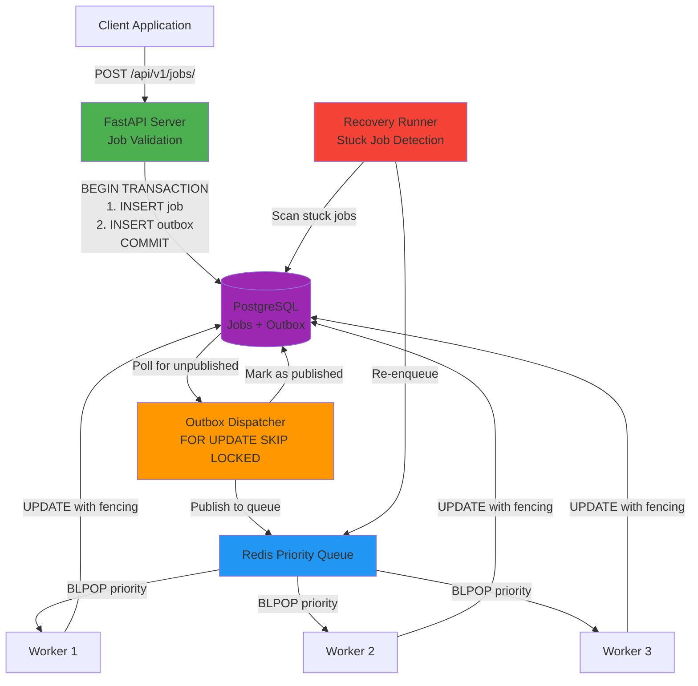

# Distributed Job Processing Platform

A production-focused distributed job processing system demonstrating transactional outbox pattern, worker fencing, job recovery, and distributed coordination. Built with Python, FastAPI, PostgreSQL, and Redis.

**Key Features:** Transactional outbox for reliable job delivery • Worker fencing to prevent stale updates • Automatic retry with dead letter queue • Priority-based job execution • Real-time WebSocket updates • Comprehensive test suite (345 passing tests)

---

## Table of Contents

- [Problem Statement](#problem-statement)
- [Solution Architecture](#solution-architecture)
- [Key Features](#key-features)
- [Technology Stack](#technology-stack)
- [System Architecture](#system-architecture)
- [Getting Started](#getting-started)
- [Usage Examples](#usage-examples)
- [Testing](#testing)
- [Monitoring](#monitoring)
- [Security Considerations](#security-considerations)
- [Known Limitations](#known-limitations)
- [Project Structure](#project-structure)

---

## Problem Statement

Distributed job processing systems face reliability challenges:

1. **Dual-Write Problem**: Writing to database and queue separately creates consistency risks
   - If queue publish fails after DB commit → job saved but never executed
   - If DB commit fails after queue publish → job executes against inconsistent state
   - Network partitions can cause similar issues

2. **Worker Coordination**: Multiple workers processing jobs concurrently need:
   - Atomic job claiming to prevent duplicate execution
   - Fencing to prevent stale worker updates after timeouts
   - Recovery mechanisms for stuck or failed jobs

3. **Reliability vs Latency**: Traditional solutions trade consistency for performance or add complex distributed transactions

## Solution Architecture

This system implements the **Transactional Outbox Pattern** to solve the dual-write problem:

```
┌─────────────────────────────────────────────────────┐
│  1. Client submits job                              │
│  2. API writes job + outbox event in ONE transaction│
│  3. Dispatcher polls outbox, publishes to Redis     │
│  4. Workers claim and execute jobs with fencing     │
└─────────────────────────────────────────────────────┘
```

**Guarantees:**
- **Atomicity**: Job and outbox event committed together (transaction)
- **Durability**: Events survive Redis failures and application crashes
- **At-Least-Once Delivery**: Jobs are delivered at least once (may be duplicated in failure scenarios)
- **Idempotency Support**: Duplicate detection via idempotency keys

**Trade-offs:**
- Adds latency (dispatcher polling interval + DB round-trip)
- Requires idempotent job handlers for correctness
- More complex than direct queue publishing

## Key Features

### ✅ Verified in End-to-End Testing

- **Transactional Outbox Pattern** - Atomic job creation with delivery guarantees
- **Concurrent Job Processing** - Multiple workers process jobs in parallel (verified: 5 jobs across 3 workers)
- **Worker Fencing** - Prevents stale worker completions after timeout/crash
- **Priority Queue** - 0-10 priority levels (verified: high priority jobs start first)
- **Automatic Retry** - Configurable max retries with exponential backoff (verified: 2 retries → dead letter)
- **Idempotency Keys** - Prevent duplicate job creation (verified: same ID returned)
- **Dead Letter Queue** - Isolate exhausted jobs for manual review
- **Job Recovery** - Stuck job detection and automatic recovery
- **Real-time Updates** - WebSocket support for live job status
- **Prometheus Metrics** - Job throughput, latency, and failure tracking
- **RESTful API** - FastAPI with automatic OpenAPI documentation

### 🔄 Simulated Job Handlers

Six job types with simulation logic (not actual business operations):
- `data_processing` - Simulates batch data processing
- `email_notification` - Simulates email sending
- `report_generation` - Simulates report creation
- `data_sync` - Simulates database synchronization
- `image_processing` - Simulates image transformations
- `backup` - Simulates backup operations

**Note**: Handlers demonstrate the execution framework with mock delays and responses. They do not perform actual email sending, image processing, database backups, etc.

## Technology Stack

| Component | Technology | Purpose |
|-----------|-----------|---------|
| **API Framework** | FastAPI 0.115+ | High-performance async REST API |
| **Database** | PostgreSQL 15 | Job persistence and outbox pattern |
| **ORM** | SQLAlchemy 2.0 (async) | Database operations with full async support |
| **Queue** | Redis 7 | Priority queue for job distribution |
| **Language** | Python 3.11+ | Core application language (compatible with 3.13) |
| **Migrations** | Alembic | Database schema versioning |
| **Monitoring** | Prometheus | Metrics collection and visualization |
| **Containerization** | Docker Compose | Local development environment |
| **Testing** | Pytest, pytest-asyncio | Test automation (345 passing tests) |

## System Architecture

### High-Level Overview



### Job Lifecycle

1. **Job Submission**
   ```
   Client → API: POST /api/v1/jobs/
   API → PostgreSQL: BEGIN TRANSACTION
     - INSERT INTO jobs (...)
     - INSERT INTO job_outbox (job_id, event_type, ...)
   API → PostgreSQL: COMMIT
   API → Client: 201 Created {job_id, status: "queued"}
   ```

2. **Outbox Publishing**
   ```
   Dispatcher polls: SELECT ... FROM job_outbox
                     WHERE published_at IS NULL
                     FOR UPDATE SKIP LOCKED LIMIT 10
   Dispatcher → Redis: ZADD queue {priority} {job_id}
   Dispatcher → PostgreSQL: UPDATE job_outbox SET published_at = NOW()
   ```

3. **Worker Execution**
   ```
   Worker → Redis: BLPOP queue (blocking, priority-ordered)
   Worker → PostgreSQL: UPDATE jobs SET status='processing', worker_id='worker-1'
                        WHERE id = ? AND status = 'queued'  -- Atomic claim
   Worker executes job handler
   Worker → PostgreSQL: UPDATE jobs SET status='completed', result=?
                        WHERE id = ? AND worker_id = 'worker-1'  -- Fencing
   ```

4. **Failure & Retry**
   ```
   On failure:
   Worker → PostgreSQL: UPDATE jobs SET status='retrying', retry_count=retry_count+1
   Worker → Redis: ZADD queue {priority} {job_id, retry_attempt}

   On exhaustion (retry_count >= max_retries):
   Worker → PostgreSQL: UPDATE jobs SET status='dead_letter', is_dead_letter=true
   ```

### Transactional Outbox Details

**Why Outbox?**
- Guarantees job delivery even if Redis is temporarily unavailable
- Provides audit trail of all job events
- Enables recovery from dispatcher crashes

**Concurrency Safety:**
- PostgreSQL `FOR UPDATE SKIP LOCKED` prevents duplicate processing
- Multiple dispatcher instances can run safely without coordination

**Delivery Semantics:**
- **At-Least-Once**: Jobs may be published multiple times if dispatcher crashes after Redis publish but before marking as published
- **Idempotency Required**: Job handlers must be idempotent to handle duplicates

### Worker Fencing

Prevents stale worker completions after timeout or crash:

```python
# Worker claims job
UPDATE jobs
SET status = 'processing', worker_id = 'worker-1', started_at = NOW()
WHERE id = ? AND status = 'queued'  -- Atomic claim

# Worker completes with fencing
UPDATE jobs
SET status = 'completed', result = ?, completed_at = NOW()
WHERE id = ? AND worker_id = 'worker-1' AND status = 'processing'
-- ^^^^^^^^^ Fencing: only THIS worker can update
```

**Protection:**
- Worker 1 claims job, starts processing
- Worker 1 appears stuck (network issue, long GC pause)
- Recovery system detects timeout, re-enqueues job with new retry_attempt
- Worker 2 claims job with retry_attempt=1
- Worker 1 finally completes → UPDATE fails (retry_attempt mismatch)
- Worker 2's completion succeeds

### Job Recovery

Automatic detection and recovery of stuck jobs:

```python
# Recovery runner scans for stuck jobs
SELECT * FROM jobs
WHERE status = 'processing'
  AND started_at < NOW() - INTERVAL '5 minutes'
  AND last_heartbeat_at < NOW() - INTERVAL '2 minutes'

# Creates recovery event
INSERT INTO job_outbox (job_id, event_type='job_recovered', retry_attempt=...)

# Dispatcher publishes to queue with retry_attempt
# Workers validate retry_attempt before claiming
```

## Getting Started

### Prerequisites

- **Docker and Docker Compose** (for infrastructure)
- **Python 3.11+** (tested with 3.11, compatible with 3.13)
- **Git**

### Quick Start (Recommended)

1. **Clone repository**
   ```bash
   git clone https://github.com/yourusername/distributed-job-processing-platform.git
   cd distributed-job-processing-platform
   ```

2. **Configure environment**
   ```bash
   cp .env.example .env
   ```

   Edit `.env` and set a secure SECRET_KEY (minimum 32 characters):
   ```bash
   # Generate a secure key
   python -c "import secrets; print(secrets.token_urlsafe(32))"

   # Add to .env
   SECRET_KEY=your-generated-key-here
   ```

3. **Start all services**
   ```bash
   docker-compose up -d
   ```

   This starts 9 services:
   - `postgres`: PostgreSQL 15 database
   - `redis`: Redis 7 queue
   - `api`: FastAPI server (port 8000)
   - `worker1`, `worker2`, `worker3`: Three worker instances
   - `dispatcher`: Outbox dispatcher process
   - `recovery`: Stuck job recovery runner
   - `prometheus`: Metrics collection (port 9090)

4. **Verify services**
   ```bash
   docker-compose ps
   curl http://localhost:8000/health
   # Expected: {"status":"healthy","version":"1.0.0"}
   ```

5. **Access application**
   - **API Documentation**: http://localhost:8000/docs
   - **API**: http://localhost:8000/api/v1/jobs/
   - **Metrics**: http://localhost:8000/metrics
   - **Prometheus**: http://localhost:9090

### Manual Setup (Development)

<details>
<summary>Click to expand manual setup instructions</summary>

1. **Create virtual environment**
   ```bash
   python3 -m venv venv
   source venv/bin/activate  # On Windows: venv\Scripts\activate
   ```

2. **Install dependencies**
   ```bash
   pip install -r requirements.txt
   ```

3. **Start infrastructure**
   ```bash
   docker-compose up -d postgres redis prometheus
   ```

4. **Configure environment**
   ```bash
   cp .env.example .env
   # Edit .env with your configuration
   ```

5. **Run migrations**
   ```bash
   alembic upgrade head
   ```

6. **Start services** (in separate terminals)
   ```bash
   # Terminal 1: API
   uvicorn app.main:app --reload --host 0.0.0.0 --port 8000

   # Terminal 2: Dispatcher
   python -m app.dispatcher.dispatcher_cli \
     --dispatcher-id dispatcher-01 --batch-size 10 --poll-interval 5.0

   # Terminal 3-5: Workers
   python -m app.worker.worker --worker-id worker-1
   python -m app.worker.worker --worker-id worker-2
   python -m app.worker.worker --worker-id worker-3

   # Terminal 6: Recovery (optional)
   python -m app.recovery.recovery_cli \
     --runner-id recovery-01 --batch-size 10 --poll-interval 60
   ```
</details>

## Usage Examples

### Create a Job

```bash
curl -X POST http://localhost:8000/api/v1/jobs/ \
  -H "Content-Type: application/json" \
  -d '{
    "job_type": "data_processing",
    "payload": {"data": [1, 2, 3, 4, 5]},
    "priority": 5,
    "max_retries": 3,
    "timeout": 300
  }'
```

**Response:**
```json
{
  "id": "a3b4c5d6-e7f8-9012-3456-789abcdef012",
  "job_type": "data_processing",
  "payload": {"data": [1, 2, 3, 4, 5]},
  "priority": 5,
  "status": "queued",
  "created_at": "2024-01-15T10:30:00Z",
  "max_retries": 3,
  "retry_count": 0,
  "timeout": 300
}
```

### Create Job with Idempotency

```bash
curl -X POST http://localhost:8000/api/v1/jobs/ \
  -H "Content-Type: application/json" \
  -d '{
    "job_type": "email_notification",
    "payload": {"recipient": "user@example.com", "subject": "Welcome"},
    "idempotency_key": "welcome-email-user123",
    "priority": 1
  }'
```

Submitting the same `idempotency_key` again returns the original job without creating a duplicate.

### Check Job Status

```bash
# Get specific job
curl http://localhost:8000/api/v1/jobs/a3b4c5d6-e7f8-9012-3456-789abcdef012

# List all jobs
curl http://localhost:8000/api/v1/jobs/

# Filter by status
curl "http://localhost:8000/api/v1/jobs/?status=completed&page_size=20"
```

### Supported Job Types

All handlers include simulation logic (2-6 second delays):

1. **data_processing**
   ```json
   {"job_type": "data_processing", "payload": {"data": [1,2,3,4,5]}}
   ```
   Returns: `{"status": "success", "processed_count": 5}`

2. **email_notification**
   ```json
   {"job_type": "email_notification", "payload": {"recipient": "user@example.com", "subject": "Test"}}
   ```
   Returns: `{"status": "success", "recipient": "user@example.com", "sent_at": "..."}`

3. **report_generation**
   ```json
   {"job_type": "report_generation", "payload": {"report_type": "sales", "start_date": "2024-01-01"}}
   ```
   Returns: `{"status": "success", "report_url": "https://example.com/reports/sales.pdf"}`

4. **data_sync**
   ```json
   {"job_type": "data_sync", "payload": {"source": "db1", "destination": "db2"}}
   ```
   Returns: `{"status": "success", "records_synced": 1000}`

5. **image_processing**
   ```json
   {"job_type": "image_processing", "payload": {"image_url": "...", "operations": ["resize"]}}
   ```
   Returns: `{"status": "success", "processed_url": "..."}`

6. **backup**
   ```json
   {"job_type": "backup", "payload": {"resource": "database", "location": "s3://..."}}
   ```
   Returns: `{"status": "success", "backup_size_mb": 150}`

**Note**: These handlers simulate work with `asyncio.sleep()` and return mock results. They demonstrate the job execution framework but do not perform actual business operations.

### Real-Time Updates

```javascript
// WebSocket connection for job updates
const ws = new WebSocket('ws://localhost:8000/api/v1/ws/jobs/JOB_ID');

ws.onmessage = (event) => {
  const update = JSON.parse(event.data);
  console.log('Job status:', update.status);
  // Job status: processing
  // Job status: completed
};

// Keep connection alive
setInterval(() => ws.send('ping'), 30000);

// Manually refresh status
ws.send('refresh');
```

## Testing

### Test Suite Overview

**Results**: 345 tests passed, 0 failed (verified 2024-11-23)

**Coverage includes:**
- Atomic job claiming (33 tests)
- Worker fencing (7 tests)
- Job status fencing (13 tests)
- Recovery integration (23 tests)
- Outbox dispatcher (29 tests)
- Queued recovery dispatcher (22 tests)
- Reconciliation durability (7 tests)
- Recovery CLI lifecycle (29 tests)
- Recovery eligibility (10 tests)
- Redis connection cleanup (7 tests)
- Worker processing loop (14 tests)
- Concurrent idempotency (14 tests)
- Plus: Migration tests, delayed queue tests, crash scenarios

### Run Tests Locally

```bash
# All tests
pytest

# With coverage report
pytest --cov=app --cov-report=html --cov-report=term

# Specific test module
pytest tests/test_outbox_dispatcher.py -v

# Fast subset
pytest tests/test_worker_fencing.py tests/test_job_status_fencing.py -v
```

### End-to-End Verification

**Verified Scenarios** (live Docker Compose environment):

| Test | Result | Evidence |
|------|--------|----------|
| Concurrent processing | ✅ PASS | 5 jobs distributed across 3 workers |
| Idempotency | ✅ PASS | Same key returned identical job ID |
| Retry behavior | ✅ PASS | Job retried 2x, then moved to dead_letter |
| Priority queue | ✅ PASS | High priority (1) started before low (9) |
| All 6 job handlers | ✅ PASS | All completed with mock results |
| Outbox publishing | ✅ PASS | Dispatcher logs show successful publishes |

**Not Tested**:
- Worker crash recovery (requires container restart)
- Network partition scenarios (requires network manipulation)

### CI Pipeline

GitHub Actions runs on every push/PR:
- Code formatting (Black)
- Linting (Flake8)
- Type checking (MyPy)
- Full test suite
- PostgreSQL 15 and Redis 7 service containers

## Monitoring

### Prometheus Metrics

Access Prometheus at http://localhost:9090

**Available Metrics:**
- `job_submissions_total` - Job submissions by type and priority
- `job_completions_total` - Completions by type and status
- `job_processing_duration_seconds` - Processing time histogram
- `job_queue_depth` - Current queue depth by priority
- `active_workers` - Number of active workers
- `job_retries_total` - Retry attempts by type
- `job_failures_total` - Failures by type and error

**Example Queries:**
```promql
# Job completion rate (jobs/second)
rate(job_completions_total[5m])

# Average processing time
avg(job_processing_duration_seconds)

# Success rate percentage
100 * (
  sum(job_completions_total{status="completed"}) /
  sum(job_completions_total)
)

# Queue backlog
sum(job_queue_depth)
```

### Application Logs

```bash
# View all logs
docker-compose logs -f

# Specific service
docker-compose logs -f dispatcher
docker-compose logs -f worker1

# Last 100 lines
docker-compose logs --tail=100 api
```

Logs use structured JSON format:
```json
{
  "event": "outbox_event_published",
  "event_id": "56eb6368-98b3-4c48-be3d-120084b8c10f",
  "job_id": "4ae87669-e435-479e-b0e1-e9b2bb8c05c1",
  "job_type": "data_processing",
  "attempt": 1,
  "level": "info",
  "timestamp": "2026-11-23T13:33:30.033467Z"
}
```

### API Endpoints

- **Health**: `GET /health`
- **Metrics**: `GET /metrics` (Prometheus format)
- **Job Stats**: `GET /api/v1/jobs/stats/overview`
- **Worker Metrics**: `GET /api/v1/workers/metrics/overview`
- **Queue Status**: `GET /api/v1/monitoring/queue`
- **Dashboard**: `GET /api/v1/monitoring/dashboard`

## Security Considerations

### Current Security Posture

⚠️ **This is a portfolio/demonstration project, not production-ready.**

**Known Security Limitations:**

1. **No Authentication** - All API endpoints are publicly accessible
2. **No Rate Limiting** - API can be overwhelmed by rapid requests (SlowAPI dependency present but not enforced)
3. **CORS Configuration** - Defaults allow `localhost:3000` and `localhost:8000`
4. **Database Credentials** - Docker Compose uses weak `postgres:postgres` credentials
5. **No Input Validation** - Job payloads are accepted without schema validation
6. **No Authorization** - No role-based access control or user management

**Before Production Deployment:**
- [ ] Implement JWT or API key authentication
- [ ] Enable rate limiting (SlowAPI middleware)
- [ ] Restrict CORS origins to specific domains
- [ ] Use strong database credentials and secrets management
- [ ] Add job payload schema validation
- [ ] Implement user authentication and RBAC
- [ ] Enable HTTPS/TLS for all endpoints
- [ ] Set up WAF and DDoS protection
- [ ] Regular security audits and dependency updates

### Configuring CORS

CORS origins can be configured via environment variable:

```bash
# .env
CORS_ORIGINS=http://localhost:3000,http://localhost:8000

# For development with any origin (not recommended for production)
CORS_ORIGINS=*
```

### Safe Deployment Practices

If adapting this project for production:
- Deploy behind API gateway with authentication
- Use managed PostgreSQL and Redis (AWS RDS, ElastiCache)
- Enable encryption at rest and in transit
- Implement audit logging for all job operations
- Use secrets manager (AWS Secrets Manager, HashiCorp Vault)
- Set up monitoring and alerting (PagerDuty, Datadog)

## Known Limitations

### Delivery Semantics

**At-Least-Once Delivery** - Jobs may be delivered multiple times:
- Dispatcher crashes after Redis publish but before marking as published
- Worker timeouts may cause job re-delivery
- **Mitigation**: Job handlers must be idempotent

**Not Exactly-Once** - System cannot guarantee exactly-once execution:
- Requires idempotency keys for client-side deduplication
- Handlers should check for duplicate execution

### Worker Scaling

**Horizontal Scaling Limitations:**
- Redis single instance is a bottleneck (use Redis Cluster for production)
- PostgreSQL connection pool limits concurrent workers
- Dispatcher polling adds latency (5-second default interval)

**Performance Characteristics** (not benchmarked):
- Suitable for I/O-bound jobs (network, database operations)
- Not optimized for CPU-intensive workloads
- Job throughput depends on handler execution time

### Job Handlers

**Simulation Only** - All 6 job type handlers are simulations:
- Use `asyncio.sleep()` to simulate work
- Return mock data (fake URLs, timestamps, counts)
- Do not perform actual email sending, image processing, database backups, etc.

**To Add Real Handlers:**
1. Edit `app/worker/job_executor.py`
2. Replace `await asyncio.sleep()` with actual business logic
3. Add necessary dependencies (boto3, PIL, sendgrid, etc.)
4. Implement error handling and retry logic

### Recovery Limitations

**Worker Crash Recovery** - Not verified end-to-end:
- Tests verify recovery logic
- Live container restart testing not performed
- Manual intervention may be required for stuck jobs

**Network Partition Handling** - Not tested:
- System designed to handle Redis failures
- PostgreSQL network issues not specifically tested
- May require manual recovery in extreme scenarios

## AWS Infrastructure (Optional)

This repository includes Terraform configurations for AWS ECS deployment in the `infrastructure/` directory.

⚠️ **Status**: Not deployed or end-to-end validated

**Included:**
- 12 Terraform files (~600 lines) for ECS Fargate, RDS, ElastiCache, ALB
- Deployment scripts and GitHub Actions workflow
- Cost estimate: ~$177/month

**Use Case**:
- Starting template for AWS deployment
- Reference architecture for distributed systems on AWS
- Not production-validated

**Before Use:**
- Review and test all Terraform configurations
- Validate security group rules and IAM policies
- Test deployment in non-production environment first
- Update cost estimates based on actual usage

## Project Structure

```
distributed-job-processing-platform/
├── app/
│   ├── api/v1/endpoints/     # API endpoints (jobs, workers, monitoring)
│   ├── core/                 # Configuration, database, logging, metrics
│   ├── db/                   # SQLAlchemy models (Job, JobOutbox, Worker)
│   ├── dispatcher/           # Outbox dispatcher process
│   ├── models/               # Pydantic schemas
│   ├── recovery/             # Stuck job recovery runner
│   ├── services/             # Business logic (job, queue, worker, recovery)
│   ├── worker/               # Worker implementation and job executor
│   └── main.py               # FastAPI application
├── tests/                    # 345 passing tests
│   ├── test_outbox_dispatcher.py
│   ├── test_worker_fencing.py
│   ├── test_recovery_integration.py
│   └── ...
├── alembic/                  # Database migrations (6 migrations)
├── docker/                   # Dockerfiles for API and workers
├── monitoring/               # Prometheus configuration
├── infrastructure/           # AWS Terraform (not deployed)
├── docker-compose.yml        # Local development (9 services)
├── requirements.txt          # Python dependencies
├── .env.example              # Environment template
└── README.md                 # This file
```

---

## Contributing

This is a portfolio project demonstrating distributed systems architecture. Contributions are welcome for:
- Bug fixes
- Performance improvements
- Additional test coverage
- Documentation improvements

Please open an issue before starting significant work.

## License

MIT License - See LICENSE file for details

---

**Built by**: [Latha](https://github.com/Latha2308)
**Project Focus**: Distributed systems, transactional patterns, job processing
**Test Coverage**: 345 passing tests (100% pass rate)
**Last Updated**: November 2024
